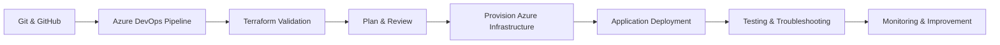

<h3>☁️ DevOps Engineer | Microsoft Azure | Terraform | CI/CD</h3>

  
  
  

**Learn • Build • Automate • Deploy • Troubleshoot • Improve**

---

## 👨‍💻 About Me

I'm an early-career **DevOps Engineer** with hands-on internship experience at **DevOps Insiders** and practical experience building, deploying, and troubleshooting cloud infrastructure and applications.

I learn DevOps by working on hands-on projects, cloud labs, automation, and real-world deployment scenarios.

- ☁️ Cloud Platform: Microsoft Azure
- 🏗️ Infrastructure as Code: Terraform
- 🔄 CI/CD: Azure DevOps YAML Pipelines
- 🐳 Containers: Docker & containerized applications
- 🔐 Security: Key Vault, Managed Identity, RBAC & security scanning
- 🌐 Networking: VNets, Subnets, NSGs, Private Endpoints & DNS
- 🖥️ OS: Linux & Windows
- 🎓 B.E. Computer Science — Jiwaji University, Gwalior (2026)
- 🎯 Career Focus: DevOps Engineer / Azure DevOps Engineer

---

## 🧰 Tech Stack & Tools

### ☁️ Cloud & Infrastructure

**Azure Services:** Virtual Machines · Resource Groups · Storage · VNets · Subnets · NSGs · Public/Private IP · Private Endpoint · Private DNS · Key Vault · Managed Identity · App Service · PostgreSQL Flexible Server

### 🏗️ Infrastructure as Code

Terraform · Modules · Variables · Outputs · Remote State · Environment Configuration · Infrastructure Automation

### 🔄 DevOps & CI/CD

Azure DevOps · YAML Pipelines · Self-hosted Agents · Service Connections · Git · GitHub · Branching · Pull Requests

### 🐳 Containers & Web Server

Docker · Images · Containers · Nginx · Reverse Proxy · Kubernetes Fundamentals · AKS Basics

### 🔐 DevSecOps & Security

TFLint · tfsec · Trivy · Infracost · Azure RBAC · Secrets Management · Infrastructure Security

### 💻 Programming & Database

Python Basics · HTML · CSS · JavaScript · React · SQL · PostgreSQL · FastAPI

### 🖥️ Operating Systems & Scripting

Linux · Windows · Bash Basics · PowerShell Basics

---

## 🚀 Featured Projects

<table>
<tr>
<td width="50%">

### 🏭 Next.Ops.Live

**Industrial Monitoring Platform**

A thermal power plant monitoring application focused on industrial telemetry.

- Frontend & Backend application
- PostgreSQL database
- Azure VM deployment
- PostgreSQL Flexible Server
- Terraform infrastructure
- Application deployment & troubleshooting
- Azure App Service deployment practice (ongoing)

**Tech:** Azure · Terraform · PostgreSQL · VM

</td>
<td width="50%">

### ⚙️ Axion System

**Azure Infrastructure & Application Project**

- Azure infrastructure provisioning with Terraform
- Virtual Machines, VNets, Subnets & NSGs
- Frontend and Backend deployment
- Docker containers
- Nginx reverse proxy
- Networking & API troubleshooting

**Tech:** Azure · Terraform · Docker · Nginx

</td>
</tr>

<tr>
<td width="50%">

### 🔐 Azure Key Vault Lab

**Secure Secrets Management**

- Azure Key Vault
- Secret management
- App Service integration
- Managed Identity
- Key Vault references
- Secure configuration practice

**Tech:** Azure · Key Vault · Managed Identity · App Service

</td>
<td width="50%">

### 🌐 Private Endpoint Lab

**Private Azure Storage Connectivity**

- Azure Storage Account
- Private Endpoint configuration
- Private DNS Zone
- DNS resolution testing
- Private HTTPS connectivity
- Static Website hosting

**Tech:** Azure Storage · Private Endpoint · DNS

</td>
</tr>

<tr>
<td width="50%">

### 🔄 Terraform + Azure DevOps

**Infrastructure Automation & CI/CD**

- Terraform modules
- Environment-based infrastructure
- Azure DevOps YAML pipelines
- Self-hosted agents
- Service Connections
- Remote State in Azure Storage
- Validation & security tools

**Tech:** Terraform · Azure DevOps · Git · YAML

</td>
<td width="50%">

### 🌍 Personal DevOps Portfolio

**Portfolio Website**

- Built using web technologies
- Hosted using GitHub Pages
- Git and GitHub source control
- Portfolio deployment practice

**Tech:** HTML · CSS · JavaScript · GitHub Pages

</td>
</tr>
</table>

---

## 🔄 My DevOps Workflow

*This represents the workflow I am learning and practicing through labs and projects. Not every stage is fully automated in every project.*

---

## 📚 Currently Learning

| Technology | Focus |
|---|---|
| 🐳 Docker | Images, Containers & deployment workflows |
| ☸️ Kubernetes | Fundamentals & orchestration |
| ☁️ AKS | Azure Kubernetes Service basics |
| 🔄 Jenkins | CI/CD automation |
| 📊 Prometheus | Metrics & monitoring |
| 📈 Grafana | Dashboards & visualization |
| 🔐 DevSecOps | Security in CI/CD |
| ☁️ Azure PaaS | App Service deployment |
| 🏗️ Terraform | Advanced concepts & best practices |

---

## 📊 GitHub Stats

---

## 🎯 Career Goal

My goal is to grow into a skilled **DevOps / Azure Cloud Engineer** by building practical experience in:

- Cloud infrastructure & architecture
- Infrastructure as Code
- CI/CD automation
- Containers & orchestration
- Monitoring & observability
- Cloud security & DevSecOps

I'm actively looking for opportunities to contribute, learn from experienced engineers, and grow through real-world engineering challenges.

---

## 🤝 Connect With Me

📧 **Email:** anilkushwaha8602@gmail.com

---

### ⚡ Learn • Build • Automate • Deploy • Improve

**Thanks for visiting my GitHub profile! 🚀**

