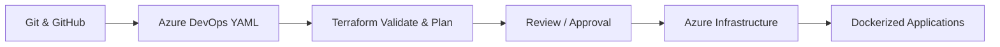

<!-- GitHub Profile README | ANIL8602 -->

  

  
  
  

    
  

## 👨‍💻 About Me

I am an early-career **DevOps Engineer** with **6+ months of hands-on internship experience** at **DevOps Insiders** (since January 2026). I enjoy building cloud infrastructure, automating deployments, and learning DevOps through practical projects.

- ☁️ **Cloud:** Microsoft Azure (VMs, VNets, Subnets, NSGs, Storage, PostgreSQL)
- 🏗️ **Infrastructure as Code:** Terraform modules, environments, and Azure remote state
- 🔁 **CI/CD:** Azure DevOps YAML pipelines, Git branching, pull requests, and approval workflows
- 🐳 **Containers:** Docker; currently strengthening Kubernetes fundamentals
- 🔐 **Security:** Azure Key Vault, Managed Identity, RBAC, and pipeline security checks
- 🎓 **Education:** B.E. in Computer Science, Jiwaji University, Gwalior (2026)
- 🎯 **Career Goal:** DevOps Engineer / Azure DevOps Engineer

## 🛠️ Tech Stack

**Cloud & Infrastructure**

**DevOps & Automation**

**Application & Tools**

## 🚀 Featured Projects

### 1. 🏭 [Axion System — Azure Infrastructure & Telemetry Platform](https://github.com/ANIL8602/axion-system-2026)

Hands-on pre-production learning project for an industrial telemetry dashboard running on Azure.

- Used **Terraform** to organize Azure infrastructure with reusable modules.
- Worked with **Azure VMs, virtual networking, NSGs, and PostgreSQL Flexible Server**.
- Deployed a **FastAPI backend** and **React frontend** using **Docker**.
- Configured **Nginx reverse proxy** to connect frontend requests to backend APIs.
- Tested private VM connectivity, API endpoints, and database access; verified telemetry responses for **8 devices**.

**Stack:** `Azure` `Terraform` `Docker` `Nginx` `FastAPI` `React` `PostgreSQL`

### 2. 🌐 [Personal DevOps Portfolio — GitHub Pages](https://github.com/ANIL8602/anil-devops-portfolio)

A responsive portfolio showcasing my DevOps learning journey and cloud projects.

- Built a portfolio with **HTML/CSS** and hosted it on **GitHub Pages**.
- Used **Git and GitHub** for source control and updates.
- Practiced basic **GitHub Pages deployment and DNS concepts**.

🔗 **[View Live Portfolio](https://anil8602.github.io/anil-devops-portfolio/)**

### 3. ⚙️ Terraform + Azure DevOps CI/CD — Practice Project

Practiced Infrastructure as Code delivery using a structured Git and Azure DevOps workflow.

- Organized **Terraform modules** for Azure resources such as virtual networks, subnets, NSGs, and VMs.
- Worked with **remote Terraform state**, branch-based changes, and pull requests.
- Practiced **YAML pipelines** with validation, plan, and review/approval steps.
- Explored security checks using **TFLint, tfsec, and Trivy** in pipeline labs.

**Stack:** `Terraform` `Azure DevOps` `Git` `Azure` `YAML`

### 4. 🔐 Azure Key Vault & Managed Identity — Hands-on Lab

Practiced securing application configuration in Microsoft Azure.

- Created **Azure Key Vault** secrets and explored access permissions.
- Used **Managed Identity** with an Azure Web App to resolve a Key Vault secret reference.
- Built a **Terraform-based Key Vault practice environment**.

**Stack:** `Azure Key Vault` `Managed Identity` `Azure App Service` `Terraform`

## 🔄 My DevOps Learning Workflow

*This diagram represents the workflow I have been practicing across my labs and projects; it is not a claim that every stage is automated in each repository.*

## 📚 Currently Improving

- Azure DevOps end-to-end CI/CD and infrastructure deployment automation
- Terraform best practices, modules, and state management
- Kubernetes fundamentals and container orchestration
- Azure monitoring, secure networking, and DevSecOps basics

## 📊 GitHub Activity

  
  

## 🤝 Let's Connect

I'm interested in **DevOps / Azure DevOps Engineer opportunities** and collaborations on practical cloud projects.

- 💼 **GitHub:** [github.com/ANIL8602](https://github.com/ANIL8602)
- 🌐 **Portfolio:** [anil8602.github.io/anil-devops-portfolio](https://anil8602.github.io/anil-devops-portfolio/)
- 📧 **Email:** [anilkushwaha8602@gmail.com](mailto:anilkushwaha8602@gmail.com)

  <b>⚡ Learn • Build • Automate • Improve ⚡</b>
   
  

